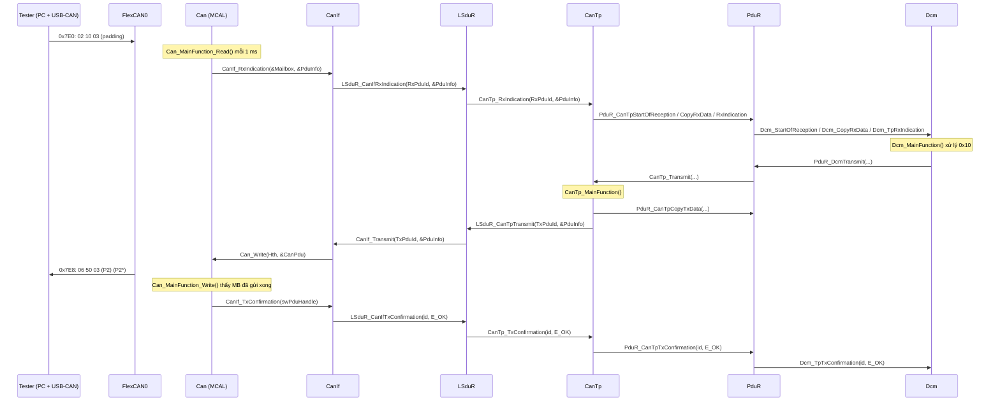

# ADR-002: Thêm MCAL Can cho S32K144 (FlexCAN) và nối đường CAN thật tới DCM

**Status:** Accepted (chủ repo duyệt ngày 2026-11-02; code của các giai đoạn chưa viết)
**Date:** 2026-11-02
**Deciders:** Chủ repo
**Liên quan:** [ADR-001](ADR-001-source-tree-layout.md) (cấu trúc thư mục). ADR này **mở rộng** ADR-001 (xem mục D6).

## Môi trường đã chốt (trả lời của chủ repo, 2026-11-02)

| Mục | Giá trị | Ghi chú |
|---|---|---|
| Board | **S32K144EVB-Q100** (NXP) | Revision: xem nhãn trên board |
| USB-CAN phía tester | **CANable** | Phiên bản (1.0 / 2.0 / Pro) và firmware (slcan hay candleLight) quyết định cách kết nối trên Windows, xem mục "Tester" bên dưới |
| Bitrate / CAN ID | **500 kbit/s**, 0x7E0 (physical Rx), 0x7DF (functional Rx), 0x7E8 (Tx) | Classic CAN |
| IDE / compiler | **S32 Design Studio for ARM v2.2**, đã cài ở `C:\NXP\S32DS_ARM_v2.2` | Kiểm tra trên máy: `arm-none-eabi-gcc` 6.3.1 (Linaro GCC 6.3-2017.06) tại `S32DS\build_tools\gcc_v6.3\gcc-6.3-arm32-eabi\bin`; S32 SDK `S32SDK_S32K1xx_RTM_3.0.0` (content register ghi Version 3.0.2) |
| Nguồn | Có **12 V** | EVB: J107 vị trí 1-2 = nguồn 12 V (theo NXP Getting Started) |

**Những gì đã kiểm tra trong S32DS đã cài** (đường dẫn tính từ `S32DS\software\S32SDK_S32K1xx_RTM_3.0.0\platform\devices\S32K144\`):

| File | Nội dung liên quan | Ảnh hưởng tới ADR |
|---|---|---|
| `include\S32K144.h` | Định nghĩa thanh ghi. Header ghi "Reference manual: S32K1XXRM Rev. 9, 09/2018", "All rights reserved" | Không commit (D5) |
| `startup\gcc\startup_S32K144.S` | Vector table; section `.FlashConfig` với `FSEC = 0xFE` ("unsecured"); Reset_Handler gọi `SystemInit` | Dùng file của NXP, không tự viết (D5) |
| `startup\system_S32K144.c/.h` | `SystemInit()` tắt watchdog khi `DISABLE_WDOG` = 1 (giá trị mặc định trong `system_S32K144.h`) | `Board_Init()` **không** phải tắt watchdog nữa (D4) |
| `linker\gcc\S32K144_64_flash.ld` | `KEEP(*(.FlashConfig))` | Dùng linker script của NXP (D5) |
| `SW-Content-Register-S32-SDK.txt`, `license.txt` | Driver và PAL của SDK: "Proprietary - LA_OPT_BASE" | Không copy code driver của SDK vào repo |

**Tester:** CANable dùng firmware **slcan** (hiện ra dạng cổng COM) hoặc **candleLight** (hiện ra dạng thiết bị USB). [Practice] Đề xuất dùng `python-can` + `udsoncan` để viết script test, và Cangaroo hoặc cantact-app để gửi frame bằng tay. Cách cài trên Windows phụ thuộc firmware và sẽ ghi trong `docs/guide/03_Board_Setup_S32K144EVB.md` sau khi xác định được firmware.

**Termination:** bus cần 120 Ω ở **hai đầu**. EVB mặc định **bỏ** termination (J108/J109 vị trí 1-2). Theo trang bán hàng, CANable có jumper hoặc nắp "120R" để bật termination. Với bus chỉ có 2 node (CANable ↔ EVB) thì phải bật termination ở cả hai, hoặc gắn thêm điện trở ngoài. *Vị trí jumper cụ thể: cần xác minh trong user guide của EVB và tài liệu CANable.*

---

## Context

### Mục tiêu

Chạy stack chẩn đoán trên board S32K144, giao tiếp CAN thật:

```
PC (tester tool) ──USB──> USB-CAN adapter ──CAN bus──> S32K144 board (FlexCAN0) ──> Can → CanIf → LSduR → CanTp → PduR → Dcm
```

### Hiện trạng repo

| Module | Trạng thái |
|---|---|
| `bsw/Dcm` | Có: 0x10, 0x3E, chạy trên PC |
| `bsw/CanTp` | Có: SF/FF/CF/FC theo R25-11, 106 check pass trên PC |
| PduR, LSduR, Det, SchM | Chỉ có **stub** (`stubs/`) |
| Can, CanIf | Chưa có |
| Build | Chỉ build trên PC (host gcc) |

### Đường đi theo spec (R25-11)

- [Spec] CanTp nằm giữa PduR và LSduR: AUTOSAR CP R25-11 SWS_CANTransportLayer, chương 1.
- [Spec] LSduR là "mandatory upper layer of all communication interface modules and mandatory lower layer of … <Bus>Tp": R25-11 SWS_LSduRouter, chương 1. Các requirement của LSduR đang ở trạng thái **DRAFT**.
- [Spec] CanIf gọi lên LSduR qua `LSduR_CanIfRxIndication` và `LSduR_CanIfTxConfirmation`. Từ R24-11, CanIf đã "Replaced upper communication layers by LSduR": R25-11 SWS_CANInterface, Document Change History và mục 7.24.2.
- [Spec] Can driver chỉ làm việc với CanIf [SWS_Can_00058]. Các callback bắt buộc nằm trong `CanIf.h` [SWS_Can_00234]: R25-11 SWS_CANDriver, mục 5.4 và 8.6.1.

### Ràng buộc từ spec CAN Driver (R25-11 SWS_CANDriver, mục 5.2)

- [SWS_Can_00238] Nếu CAN controller nằm trên chip, Can module không được dùng dịch vụ của driver khác.
- [SWS_Can_00239] `Can_Init` khởi tạo mọi tài nguyên phần cứng của CAN controller, **trừ cấu hình chân** (việc này của Port driver).
- [SWS_Can_00240] Mcu module cấu hình các thanh ghi dùng chung (ví dụ clock). Implementation hint: Mcu phải được khởi tạo **trước** Can.
- [SWS_CANIF_00317] `CanIf_Transmit` từ chối request nếu controller chưa ở `CAN_CS_STARTED` và PDU channel chưa online: R25-11 SWS_CANInterface, mục 8.3.

### Phần cứng S32K144

| Thông tin | Giá trị | Nguồn |
|---|---|---|
| Core | Arm Cortex-M4F, 80 MHz (RUN) / 112 MHz (HSRUN) | [Spec] NXP S32K1xx Data Sheet Rev. 15 (5 Mar 2026), Figure 3, trang 6 |
| Flash / System RAM | 512 KB / 64 KB | như trên |
| FlexCAN | **3 instance, 1 instance có CAN FD** | như trên |
| Chân CAN trên EVB | CAN0_TX = PTE5, CAN0_RX = PTE4 | NXP "Getting Started with the S32K144EVB" (trang web) |
| Termination trên EVB | J108/J109 vị trí 1-2 (mặc định) = **bỏ** điện trở termination | như trên |
| Nạp chương trình | OpenSDA, cổng "SDA" (J7), đã cài sẵn ứng dụng MSD Flash Programmer | như trên |
| SBC / transceiver | Các chân SBC_SCK/MISO/MOSI/CS = PTB14–PTB17 (LPSPI1). **Trang của NXP không ghi mã chip.** Diễn đàn NXP nói là UJA1169 | **Cần xác minh** trên schematic của board |

### Các yếu tố cần cân nhắc

1. **Mục tiêu học:** hiểu đường đi end-to-end và đọc được code. Không cần MCAL đạt chất lượng sản xuất.
2. **Dễ bảo trì:** mỗi hàm làm một việc; chỉ một file được đụng thanh ghi.
3. **Push lên GitHub public:** không được đưa code có license không cho phân phối lại (MCAL của NXP, header thiết bị) khi chưa kiểm tra license.
4. **`make test` trên PC phải tiếp tục chạy được** khi chưa cắm board.
5. **Lỗ hổng đã biết trong CanTp:** exclusive area hiện chỉ bảo vệ `CanTp_Transmit` ([CanTp.c:170](../../bsw/CanTp/src/CanTp.c#L170)). Nếu Can driver gọi lên từ ISR, state machine của CanTp sẽ bị race.

---

## Decision

| # | Quyết định |
|---|---|
| D1 | **Tự viết Can driver** theo API R25-11 (chỉ phần cần dùng). Tách làm 2 lớp: logic AUTOSAR (`Can.c`, không phụ thuộc chip) và truy cập phần cứng (`Can_Hw_*.c`). Có 2 bản phần cứng: FlexCAN (board) và Sim (PC). |
| D2 | **POLLING** cho Rx, Tx, BusOff, Mode (`CanRxProcessing` / `CanTxProcessing` = `POLLING`). Không dùng ISR của CAN ở giai đoạn đầu. Scheduler bare-metal 1 ms, không dùng OS. |
| D3 | **CanIf và LSduR bản tối thiểu, viết thành hàm thật**, không dùng zero-cost macro, để đọc code thấy rõ ai gọi ai. |
| D4 | **Không viết Mcu/Port driver AUTOSAR.** Dùng `Board_Init()` trong `platform/` (clock, watchdog, pin mux), gọi **trước** `Can_Init()` theo đúng thứ tự của [SWS_Can_00240]. Ghi rõ đây là điểm lệch khỏi chuẩn. |
| D5 | **Không commit file của NXP** (header thiết bị `S32K144.h`, startup, linker script). Makefile lấy các file này từ thư mục cài S32 Design Studio qua biến `S32DS_DIR`. |
| D6 | **Mở rộng ADR-001:** thêm `mcal/<M>/`, `platform/<board>/`, `app/<board>/`. Đổi quy tắc stub: stub được **giữ lại** cho unit test của module phía trên. |
| D7 | **Hai đích build:** `make test` (PC, như hiện tại, thêm test mới) và `make target BOARD=s32k144evb` (arm-none-eabi-gcc của S32DS, ra `.elf` / `.srec`). |
| D8 | **Tài liệu:** README cho từng module mới, và `docs/guide/` có sơ đồ workflow (Mermaid), bảng "ai gọi hàm nào", thứ tự init, hướng dẫn setup board và nạp chương trình. |
| D9 | **Làm theo 4 giai đoạn.** Mỗi giai đoạn có branch và PR riêng, **bạn duyệt xong mới push**. |

### D1. Can driver: phần AUTOSAR tách khỏi phần thanh ghi

```
            CanIf
              │  Can_Init / Can_SetControllerMode / Can_Write / Can_MainFunction_*
              ▼
   ┌──────────────────────────┐
   │ Can.c  (logic AUTOSAR)   │  DET check, state machine controller,
   │                          │  map Hth/Hrh → message buffer, gọi CanIf_*
   └────────────┬─────────────┘
                │  Can_Hw.h: interface NỘI BỘ, khoảng 6–8 hàm
       ┌────────┴─────────┐
       ▼                  ▼
 Can_Hw_FlexCan.c     Can_Hw_Sim.c
 (S32K144: thanh ghi) (PC: bus ảo trong RAM, cho test)
```

- [Practice] Cách tách này giúp: (1) chỉ **một file** đụng thanh ghi, dễ review; (2) logic AUTOSAR của Can được unit test trên PC; (3) đổi chip chỉ phải viết lại `Can_Hw_<chip>.c`.
- API sẽ viết (tên và signature lấy từ R25-11 SWS_CANDriver, mục 8.3 và 8.5):

| API | Requirement | Ghi chú |
|---|---|---|
| `void Can_Init(const Can_ConfigType* Config)` | SWS_Can_00223 | |
| `Std_ReturnType Can_SetControllerMode(uint8 Controller, Can_ControllerStateType Transition)` | SWS_Can_00230 | Asynchronous |
| `Std_ReturnType Can_Write(Can_HwHandleType Hth, const Can_PduType* PduInfo)` | SWS_Can_00233 | Không block [SWS_Can_00275], trả `CAN_BUSY` khi MB bận [SWS_Can_00213] |
| `Can_MainFunction_Read / _Write / _BusOff / _Mode` | SWS_Can_00226 / 00225 / 00227 / 00368 | Gọi mỗi 1 ms |

- **Không làm ở giai đoạn này:** CAN FD, wakeup, partial networking, timestamp, `Can_SetBaudrate`, `Can_DeInit`.

### D2. Vì sao chọn POLLING

- [Spec] `CanRxProcessing` (ECUC_Can_00317, container `CanController`) có 3 giá trị `INTERRUPT` / `MIXED` / `POLLING`. Khi chọn POLLING, `Can_MainFunction_Read` poll các sự kiện nhận [SWS_Can_00108].
- [Inference] Với POLLING, mọi lời gọi từ `CanIf_RxIndication` trở lên (đến CanTp) đều chạy trong **cùng một ngữ cảnh** với `CanTp_MainFunction`. Lỗ hổng race trong CanTp (mục Context, ý 5) vì vậy không xảy ra. Khi chuyển sang INTERRUPT phải sửa CanTp trước (xem Consequences).
- [Inference] **Rủi ro mất frame:** poll mỗi 1 ms, mà 1 frame classic CAN 8 byte ở 500 kbit/s mất khoảng 0,25 ms trên bus. Nếu tester gửi dồn nhiều frame tới cùng một Rx MB thì frame sau ghi đè frame trước. Cách xử lý: dùng nhiều Rx MB hoặc Rx FIFO của FlexCAN (chốt khi viết `Can_Hw_FlexCan.c`, sau khi đọc chương FlexCAN của Reference Manual). Khi ECU nhận CF, FC do CanTp gửi đã có STmin = 5 ms nên ở trường hợp này không gặp rủi ro.

### D3. CanIf và LSduR bản tối thiểu

**CanIf** (tên và signature lấy từ R25-11 SWS_CANInterface, mục 8.3 và 8.4):

| API | Requirement |
|---|---|
| `void CanIf_Init(const CanIf_ConfigType* ConfigPtr)` | SWS_CANIF_00001 |
| `Std_ReturnType CanIf_SetControllerMode(uint8 ControllerId, Can_ControllerStateType ControllerMode)` | SWS_CANIF_00003 |
| `Std_ReturnType CanIf_SetPduMode(uint8 ControllerId, CanIf_PduModeType PduModeRequest)` | SWS_CANIF_00008 |
| `Std_ReturnType CanIf_Transmit(PduIdType TxPduId, const PduInfoType* PduInfoPtr)` | SWS_CANIF_00005 |
| `void CanIf_RxIndication(const Can_HwType* Mailbox, const PduInfoType* PduInfoPtr)` | SWS_CANIF_00006 |
| `void CanIf_TxConfirmation(PduIdType CanTxPduId)` | SWS_CANIF_00007 |
| `void CanIf_ControllerBusOff(uint8 ControllerId)` | SWS_CANIF_00218 |
| `CanIf_ControllerModeIndication(...)` | mục 8.4.11, signature đọc khi viết code |

- Không có Tx buffering (`CanIfPublicTxBuffering` = tắt [SWS_CANIF_00063]). Khi `Can_Write` trả `CAN_BUSY`, `CanIf_Transmit` trả `E_NOT_OK` và CanTp tự xử lý.
  - [Spec] Note dưới [SWS_CANIF_00162]: khi `CanIf_Transmit` trả `E_NOT_OK`, "the upper layer module is responsible to repeat the transmit request".
  - **Cần xác minh:** hành vi chính xác khi `CAN_BUSY` và buffering tắt (đọc lại toàn bộ mục 7.11 khi viết code).
- Không làm: transceiver, wakeup, PN, CAN XL, mask-based routing, dynamic CAN ID.

**LSduR:** chỉ có bảng routing tĩnh (Pre-Compile):
- CanIf RxPdu → CanTp RxNPdu;
- CanTp TxNPdu → CanIf TxPdu;
- chiều ngược lại cho TxConfirmation.

[Spec] Theo [CP_SWS_LSduR_00024] có thể bỏ LSduR (zero-cost) để CanIf và CanTp gọi thẳng nhau. **Không chọn cách đó**, vì mục tiêu là nhìn thấy từng lớp khi debug.

### D4. Thay thế Mcu/Port bằng `Board_Init()`

[Practice] Viết đủ Mcu và Port driver theo AUTOSAR là một khối việc lớn và nằm ngoài mục tiêu chẩn đoán. `platform/s32k144evb/Board.c` chỉ làm 2 việc, gọi trước `Can_Init()`:

1. **Clock** cho core và FlexCAN (nguồn clock của FlexCAN quyết định bit timing). *Tần số thạch anh trên EVB: cần xác minh trên schematic.*
2. **Pin mux** PTE4/PTE5 → CAN0 (đúng vai trò Port driver theo [SWS_Can_00239]).

**Watchdog** do `SystemInit()` của NXP tắt trước khi vào `main()` (`DISABLE_WDOG` = 1, xem mục "Môi trường đã chốt"). `Board_Init()` không lặp lại việc này.

### D5. Không commit file của NXP

- `S32K144.h` (định nghĩa thanh ghi), startup code, `system_S32K144.c` và linker script được lấy từ thư mục cài **S32 Design Studio** (biến `S32DS_DIR` trong `platform/s32k144evb/board.mk`, mặc định `C:/NXP/S32DS_ARM_v2.2`).
- [Practice] Dùng startup và linker script của NXP thay vì tự viết, vì viết sai **Flash Configuration Field** (section `.FlashConfig`, byte FSEC) có thể **khóa chip**. File của NXP đặt FSEC = 0xFE (unsecured).
- **License (đã kiểm tra trên bản cài):** header của các file này ghi "All rights reserved" và không có điều khoản cho phép phân phối lại; driver của SDK theo license "Proprietary - LA_OPT_BASE". Vì vậy giữ quyết định **không commit**.
- Code của driver trong SDK (`platform/drivers/src/flexcan/...`) chỉ được **đọc để tham khảo** trình tự thanh ghi, không copy vào repo.

### D6. Cấu trúc thư mục (mở rộng ADR-001)

```
Autosar Documentation/
├── bsw/
│   ├── Dcm/, CanTp/                 (đã có, không đổi)
│   ├── CanIf/   inc/ src/           MỚI
│   ├── LSduR/   inc/ src/           MỚI
│   └── PduR/    inc/ src/           MỚI ở giai đoạn 4 (chỉ route CanTp ↔ Dcm)
├── mcal/                            MỚI: driver phụ thuộc chip (owner thật: hãng chip)
│   └── Can/
│       ├── inc/Can.h
│       ├── src/Can.c, Can_Internal.h, Can_Hw.h
│       └── hw/
│           ├── s32k144/Can_Hw_FlexCan.c     ← file DUY NHẤT đụng thanh ghi FlexCAN
│           └── host/Can_Hw_Sim.c            ← bus ảo cho test trên PC
├── gen/Can/, gen/CanIf/, gen/LSduR/, gen/PduR/   cấu hình (viết tay, đóng vai output của tool)
├── platform/                        MỚI: code của board, không phải AUTOSAR
│   └── s32k144evb/
│       ├── Board.c/.h               watchdog, clock, pin mux (thay Mcu_Init / Port_Init)
│       ├── Tick.c/.h                tick 1 ms (timer cụ thể chốt khi đọc RM)
│       ├── SchM_Platform.c          exclusive area = tắt/bật ngắt
│       └── board.mk                 cờ compiler, S32DS_DIR
├── app/                             MỚI
│   └── s32k144evb/main.c            thứ tự init + vòng lặp 1 ms
├── stubs/
│   ├── General/Can_GeneralTypes.h   MỚI: type dùng chung Can/CanIf [SWS_Can_00436]
│   └── ...                          (giữ nguyên, dùng cho unit test)
├── test/
│   ├── Can/, CanIf/, LSduR/         unit test (PC)
│   └── Integration/                 toàn chuỗi Can_Hw_Sim → … → Dcm trên PC
└── docs/
    ├── adr/ADR-002-...md            (file này)
    └── guide/                       MỚI: tài liệu hướng dẫn (D8)
```

**Sửa quy tắc của ADR-001:**

| Quy tắc cũ (ADR-001) | Quy tắc mới |
|---|---|
| "Khi đã có module thật, xóa stub" | Stub **giữ lại** cho unit test của module phía trên, ví dụ test CanTp vẫn dùng `stubs/LSduR`. Module thật chỉ được link trong `test/Integration` và trong build cho board. |
| Include path chung: `bsw/*/inc` | Thêm `mcal/*/inc`. `mcal/<M>/src` và `mcal/<M>/hw/<platform>` là private, giống `bsw/<M>/src`. |
| (chưa có) | Code trong `bsw/` và `mcal/<M>/src/` **không được** include `S32K144.h`. Chỉ `mcal/<M>/hw/s32k144/` và `platform/s32k144evb/` được include. |

### D7. Build

| Lệnh | Compiler | Link với | Kết quả |
|---|---|---|---|
| `make test` | gcc (PC) | stub + `Can_Hw_Sim.c` | chạy unit test và integration test |
| `make sim` | gcc (PC) | như hiện tại | `CanTp_Sim` |
| `make target BOARD=s32k144evb` | `arm-none-eabi-gcc` 6.3.1 trong S32DS v2.2 | module thật + `Can_Hw_FlexCan.c` + `platform/` + startup/system/linker của NXP | `out/s32k144evb/app.elf`, `.srec` |

Nạp chương trình: kéo-thả file `.srec` vào ổ đĩa OpenSDA (MSD), hoặc debug bằng S32DS (import file `.elf`). *Định dạng file mà ứng dụng MSD chấp nhận: cần xác minh trong OpenSDA User's Guide.*

### D8. Tài liệu sẽ viết

| File | Nội dung |
|---|---|
| `docs/guide/01_ComStack_Walkthrough.md` | Sơ đồ layer; sequence diagram (Mermaid) cho: nhận SF, nhận multi-frame + FC, gửi multi-frame, TxConfirmation; bảng **"ai gọi hàm nào"** (caller → callee → API → header → ngữ cảnh chạy) |
| `docs/guide/02_Init_And_Scheduling.md` | Thứ tự init, vì sao theo thứ tự đó, thứ tự gọi MainFunction trong 1 ms |
| `docs/guide/03_Board_Setup_S32K144EVB.md` | Nối dây, jumper, termination 120 Ω, nguồn, USB-CAN, cài S32DS, build, nạp, kiểm tra từng bước |
| `docs/guide/04_Troubleshooting.md` | Không có ACK, bus-off, sai bit timing, frame bị mất, DET error: triệu chứng → nguyên nhân → cách kiểm tra |
| `mcal/Can/README.md`, `bsw/CanIf/README.md`, `bsw/LSduR/README.md` | Theo mẫu của `bsw/CanTp/README.md`: vì sao có module, bảng 5 điểm, file, cấu hình, truy vết requirement, giới hạn |

**Mẫu sơ đồ sẽ có trong `01_ComStack_Walkthrough.md`** (request 0x10 dạng SF):



**Thứ tự init và vòng lặp chính dự kiến** (`app/s32k144evb/main.c`):

```
Board_Init()                      watchdog, clock, pin  (vai trò Mcu_Init + Port_Init, phải chạy TRƯỚC Can_Init [SWS_Can_00240])
Can_Init(&Can_Config)
CanIf_Init(&CanIf_Config)
LSduR / CanTp / PduR / Dcm Init
ComStack_Start()                  CanIf_SetControllerMode(CAN_CS_STARTED) → chờ mode indication → CanIf_SetPduMode(ONLINE)
                                  (trong AUTOSAR thật đây là việc của CanSM/ComM/BswM, xem mục "Không làm")
loop mỗi 1 ms:
    Can_MainFunction_Mode()
    Can_MainFunction_Read()       frame mới → CanIf → LSduR → CanTp
    CanTp_MainFunction()
    Dcm_MainFunction()
    Can_MainFunction_Write()      confirmation → CanIf → LSduR → CanTp
    Can_MainFunction_BusOff()
```

[Practice] Thứ tự đọc → xử lý → ghi giúp request nhận được trong chu kỳ 1 ms nào thì được xử lý ngay trong chu kỳ đó. Thứ tự này không do spec quy định.

### D9. Bốn giai đoạn (mỗi giai đoạn: bạn duyệt → push branch riêng)

| GĐ | Nội dung | Kiểm tra trên PC | Kiểm tra trên board | Branch |
|---|---|---|---|---|
| 1 | Build cho board + `Board_Init` + `Can` (FlexCAN0, classic CAN, POLLING) + app "CAN echo" (nhận frame nào gửi lại frame đó với ID khác) | Unit test `Can.c` với `Can_Hw_Sim` | Tester gửi 1 frame, thấy frame echo. Chứng minh clock, bit timing, chân, transceiver đều đúng | `feature/mcal-can` |
| 2 | `CanIf` + `LSduR` bản tối thiểu | Unit test từng module + integration Can→CanIf→LSduR | Echo đi qua CanIf/LSduR | `feature/canif-lsdur` |
| 3 | Nối CanTp, upper layer là một "loopback" (nhận N-SDU nào trả lại N-SDU đó) | Integration test toàn chuỗi tới CanTp: SF/FF/CF/FC | Tester gửi 27 byte → FF/FC/CF và nhận lại multi-frame | `feature/cantp-on-target` |
| 4 | `PduR` tối thiểu (CanTp ↔ Dcm), chạy Dcm thật | Integration test: `10 03` → `50 03 …`, `3E 00` | Tester (CANable + python-can/udsoncan) gửi 0x10, 0x3E | `feature/dcm-on-target` |

Ghi chú: ADR này được push trước lên branch `feature/mcal-can`. Code của giai đoạn 1 sẽ nằm trên cùng branch đó, sau khi chủ repo duyệt.

---

## Options Considered (cho D1: lấy Can driver từ đâu)

### Option A: Dùng MCAL của NXP (Real-Time Drivers, RTD cho S32K1)

| Dimension | Assessment |
|---|---|
| Complexity | Med–High: phải cấu hình bằng S32DS / EB tresos |
| Đồng bộ release | **Lệch:** NXP Community nói RTD cho S32K1 cài đặt AUTOSAR **R21-11** (chưa phải tài liệu chính thức, cần xác minh trên trang tải của NXP). Repo đang theo **R25-11** (có LSduR). |
| Push lên GitHub | **Không** (code của NXP; license phải kiểm tra) |
| Giá trị học | Thấp với phần Can (hộp đen), cao với cách làm việc thật trong dự án |
| Rủi ro lỗi phần cứng | Thấp: driver đã được NXP kiểm thử |
| Test trên PC | Không |

**Pros:** đúng cách làm của dự án sản xuất [Practice]; ít lỗi thanh ghi.
**Cons:** lệch release; không push được; không unit test trên PC; người đọc repo không xem được code.

### Option B: Tự viết Can driver theo API R25-11, tách lớp phần cứng (ĐÃ CHỌN)

| Dimension | Assessment |
|---|---|
| Complexity | Med: phải đọc chương FlexCAN của Reference Manual |
| Đồng bộ release | Đúng R25-11 |
| Push lên GitHub | Có (chỉ code mình viết, không kèm file NXP) |
| Giá trị học | Cao: thấy được cả `Can_Write` → message buffer → `CanIf_TxConfirmation` |
| Rủi ro lỗi phần cứng | Med: giảm bằng giai đoạn 1 (echo) chỉ kiểm tra phần cứng |
| Test trên PC | Có (`Can_Hw_Sim`) |

**Pros:** đọc hiểu được, test được, đúng release, push được.
**Cons:** không đạt chất lượng sản xuất; tốn công đọc Reference Manual; có thể có lỗi thanh ghi mà driver của NXP đã xử lý.

### Option C: Dùng lớp low-level của NXP (FlexCAN_Ip trong RTD) và bọc bằng API `Can_*`

| Dimension | Assessment |
|---|---|
| Complexity | Med |
| Đồng bộ release | API `Can_*` do mình viết nên theo R25-11 được |
| Push lên GitHub | **Không** với phần code NXP |
| Giá trị học | Trung bình: phần thanh ghi vẫn là hộp đen |
| Rủi ro lỗi phần cứng | Thấp |
| Test trên PC | Có, nếu bọc qua `Can_Hw.h` |

**Pros:** ít lỗi thanh ghi.
**Cons:** vẫn phụ thuộc code không push được; thêm một tầng; repo không tự build được.

## Trade-off Analysis

- **A:** gần với dự án thật nhất, nhưng phá hai yêu cầu: repo public phải build được, và release thống nhất R25-11 (RTD không có LSduR nếu đúng là R21-11).
- **C:** giảm rủi ro thanh ghi, nhưng vẫn vướng license và thêm một tầng khó đọc.
- **B:** tốn công nhất ở file `Can_Hw_FlexCan.c`. Rủi ro này được khoanh vào **một file** và được kiểm tra riêng ở giai đoạn 1, trước khi đặt CanTp/Dcm lên trên. Khi cần chuyển sang sản xuất, chỉ cần thay `mcal/Can` bằng RTD của NXP; CanIf trở lên không đổi, vì API `Can_*` theo chuẩn.

**Polling hay Interrupt (D2):** interrupt cho độ trễ thấp hơn nhưng bắt buộc sửa CanTp (thêm exclusive area cho state Rx/Tx) và khó debug hơn. Polling 1 ms đủ cho chẩn đoán (P2 = 50 ms). Chọn polling trước, interrupt là việc của sau này.

---

## Consequences

**Dễ hơn**
- Debug theo từng lớp; mỗi giai đoạn có tiêu chí "chạy được" rõ ràng.
- Đổi chip chỉ phải viết lại `Can_Hw_<chip>.c` và `platform/<board>/`.
- Test trên PC vẫn chạy được mà không cần board.

**Khó hơn**
- Thêm 3 thư mục cấp cao (`mcal/`, `platform/`, `app/`) và một đích build cho board.
- Các ID phải khớp qua 4 module (CAN ID ↔ HRH/HTH ↔ CanIf PDU ↔ LSduR route ↔ CanTp N-PDU) mà không có tool generate. Integration test bắt lỗi lệch ID.
- Cần cài S32DS mới build được cho board.

**Không làm (giới hạn có chủ ý)**
- CanSM, ComM, BswM, EcuM: không làm. `ComStack_Start()` gọi thẳng CanIf. Khi bus-off chỉ báo DET và khởi động lại controller một cách đơn giản, **không** theo chiến lược recovery của CanSM.
- CAN FD, CanTrcv driver, wakeup, Mcu/Port driver AUTOSAR, MemMap, OS.

**Cần xem lại sau**
- Chuyển sang INTERRUPT: phải sửa CanTp trước (exclusive area cho `CanTp_RxIndication`, `CanTp_TxConfirmation`, `CanTp_MainFunction`).
- License của `S32K144.h`, startup, linker script (D5).
- Nếu SBC trên board cần cấu hình qua SPI mới bật được transceiver, sẽ cần thêm driver SBC (LPSPI1). Các báo cáo trên diễn đàn NXP mâu thuẫn nhau ở điểm này.

---

## Câu hỏi còn mở (không chặn việc bắt đầu)

1. Phiên bản CANable và firmware đang nạp (slcan hay candleLight).
2. Revision của EVB (in trên board).

## Tài liệu cần có / cần xác minh

| Tài liệu | Dùng để | Trạng thái |
|---|---|---|
| AUTOSAR CP R25-11 SWS_CANDriver, SWS_CANInterface | API, hành vi Can / CanIf | Đã tải vào `docs/specs/` (không push) |
| NXP S32K1xx Data Sheet Rev. 15 | Số FlexCAN, bộ nhớ | Đã tải vào `docs/specs/` (không push) |
| **NXP S32K1xx Reference Manual** (`S32K144.h` ghi Rev. 9, 09/2018): chương FlexCAN, SCG/PCC (clock), PORT | Viết `Can_Hw_FlexCan.c` và `Board.c` | **Chưa có** (không có trong bản cài S32DS). Tải từ nxp.com (có thể phải đăng nhập) |
| S32 SDK S32K144 User Manual | Tham khảo trình tự khởi tạo FlexCAN của NXP | Có trong bản cài: `S32SDK_S32K1xx_RTM_3.0.0\doc\S32SDK_S32K144_UserManual.pdf` |
| **Schematic / User Guide của S32K144EVB** | Chip SBC/transceiver, thạch anh, nguồn | **Chưa có** |
| OpenSDA User's Guide | Định dạng file nạp qua MSD | **Chưa có** |
| AUTOSAR Layered Software Architecture R25-11 | Layer của CanIf / LSduR | **Chưa có** |

## Action Items

1. [x] Chủ repo duyệt ADR này và trả lời 5 câu hỏi (2026-11-02).
2. [ ] Bổ sung Reference Manual và schematic vào `docs/specs/`.
3. [ ] Giai đoạn 1 → review → push `feature/mcal-can`.
4. [ ] Giai đoạn 2 → review → push `feature/canif-lsdur`.
5. [ ] Giai đoạn 3 → review → push `feature/cantp-on-target`.
6. [ ] Giai đoạn 4 → review → push `feature/dcm-on-target`.
7. [ ] Viết `docs/guide/01`–`04` dần theo từng giai đoạn (mỗi PR kèm phần tài liệu của nó).
8. [x] Đổi Status của ADR thành **Accepted**; cập nhật ADR-001 trỏ sang ADR-002.
